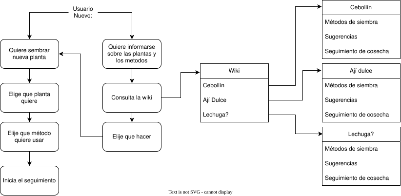

# PWA PARA LA GESTIÓN DE HUERTOS DOMESTICOS
---
## Wiki orientada al aprendizaje de los diferentes tipos de siembra

### Macetas

### Hidroponico

### Huerto

## Sistema de seguimiento de la planta ya sembrada
---
## Diagrama de funcionalidad (versión simplificada simplificada)

